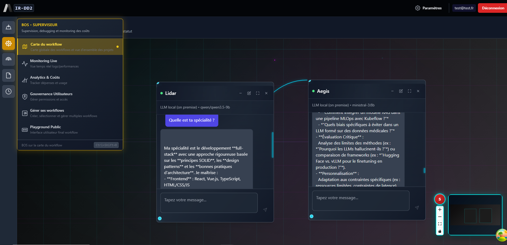
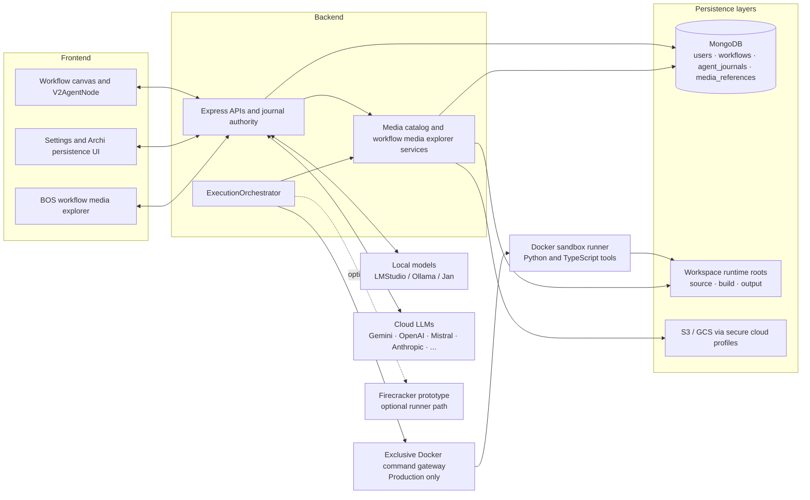

# A-IR-DD2 — AI Robot Design & Development System V2

[](https://opensource.org/licenses/MIT)
[](https://www.typescriptlang.org/)
[](https://reactjs.org/)
[](https://nodejs.org/)
[](https://www.mongodb.com/)
[](https://www.python.org/)
🇫🇷 [Voir la description en français](#-à-propos)

---

> **A visual multi-agent orchestration platform — design, configure and run specialized AI agents on an interactive workflow canvas.**

A-IR-DD2 lets you build complex AI workflows through a **visual node-based editor**, powered by **9 cloud LLM providers + local on-premise models**. Agents are built from reusable prototypes, each with their own role, memory, custom functions, API connections and database nodes — all managed by a team of 5 specialized Robots.



---

## ✨ Key highlights

- 🤖 **5 specialized Robots** — each managing a dedicated domain (agents, monitoring, connections, functions, events)
- 🧩 **Visual workflow canvas** — drag, connect and chat with multiple AI agents simultaneously
- ⚡ **9 cloud LLM providers** + local on-premise models (LMStudio, Ollama-compatible)
- 🔧 **Custom function IDE** — write, test and attach Python/TypeScript functions to agents in a sandboxed environment
- 🗄️ **Multi-database connector** — PostgreSQL, MySQL, MongoDB, Redis, ElasticSearch, Oracle and more
- 🔗 **API node builder** — configure and test HTTP connections, inject them into workflows
- 🔐 **Enterprise security** — JWT auth, AES-256-GCM encrypted API keys, per-user persistence
- 🌍 **8 languages** supported (i18n)

👉 **[Explore all features →](FEATURES.md)**

---

## 🏗️ Architecture overview

```
┌─────────────────┐         ┌──────────────────┐         ┌─────────────────┐
│   Frontend      │         │   Backend Proxy  │         │  Local Models   │
│  React 19 + TS  │◄───────►│  Node.js + TS    │◄───────►│exLMStudio/Ollama│
│  React Flow     │         │  Express + JWT   │         └─────────────────┘
└─────────────────┘         └──────────────────┘
                                    │
                              JWT + AES-256-GCM
                                    │
                             ┌──────┴───────┐
                             │   MongoDB    │         ┌──────────────────┐
                             │ users/keys/  │         │  Cloud LLMs      │
                             │ workflows    │         │  Gemini · GPT-4  │
                             └──────────────┘         │  Mistral · Grok  │
                                                      │  Anthropic · ... │
                                                      └──────────────────┘
```

### Runtime, sandboxes & media persistence



- **Dockerized runtime:** MongoDB is typically started through Docker Compose, and agent code execution uses hardened Docker sandboxes as the current default runner.
- **Production Docker boundary:** on the dedicated Linux host, the backend sends sandbox, runtime-health, and native-Python provisioning commands through the `airdd2-docker-gateway` Unix socket. Only the gateway service joins the Docker group; the backend receives access to the gateway socket, not the Docker socket. Local development retains the direct Docker fallback unless `DOCKER_GATEWAY_REQUIRED=true`.
- **Sandbox outputs:** Python/TypeScript tool executions publish artifacts into workflow-scoped workspace roots, then the backend projects them into the media catalog for BOS exploration.
- **Media persistence modes:** each agent can persist media to database-backed journals, workspace storage, or cloud storage; workspace publication can remain enabled as a companion write path.
- **Cloud secret boundary:** S3/GCS credentials live in secure settings profiles, while agents only reference a profile identifier.
- **Journal + catalog model:** conversation/media writes enter the journal first, and `MediaReference` becomes the workflow-scoped read model used for preview, download, filtering, and orphan handling.

See also: [Guides/Features/MEDIAS/README.md](Guides/Features/MEDIAS/README.md)

**Stack:** React 19 · TypeScript · Tailwind · Zustand · React Flow · Node.js · Express · MongoDB · Docker · Python · Workspace runtime roots · S3/GCS profiles

---

## 🚀 Installation and first run

These steps are the supported installation path. If you complete them in order, you end with a working frontend, a working backend, MongoDB persistence, Docker sandboxes for user functions, Python native tooling, and the Node 24 verification slice used to validate workspace and sandbox execution.

> **Prerequisites:** Node.js 24.22.1 LTS, Docker Desktop with Compose support, Python 3.11+, Git

### 1. Clone the repository

```bash
git clone https://github.com/sylvainbonnecarrere/A-IR-DD2.git
cd A-IR-DD2
```

### 2. Select the supported Node runtime

The repository is pinned to Node 24.22.1 through `.nvmrc`, `.node-version`, and the `engines.node` fields.

On Windows with `nvm-windows`, open a Node 24 shell before installing or starting anything:

```powershell
. .\scripts\Enter-NodeVersionShell.ps1 -Version 24.22.1
```

Check the runtime:

```bash
node -v
```

Expected result: `v24.22.1`

### 3. Install frontend and backend dependencies

```bash
npm ci
cd backend
npm ci
cd ..
```

### 4. Create the backend environment file

Use the checked-in template as the starting point:

```bash
cp backend/.env.example backend/.env
```

If you still rely on the Docker helper file, the project also supports:

```bash
cp backend/docker/.env.docker backend/.env
```

Generate the required secrets:

```bash
cd backend
node scripts/generate-secrets.js
cd ..
```

Then update `backend/.env` with at least these values:

- `MONGO_USER`
- `MONGO_PASSWORD`
- `MONGODB_URI` using the same MongoDB credentials
- `JWT_SECRET`
- `REFRESH_TOKEN_SECRET`
- `ENCRYPTION_KEY`
- `JWT_EXPIRATION` (for example `1h`)

> Redis is intentionally not required for the supported runtime. MongoDB is the source of truth for run state and the durable queue. After MongoDB and database initialization succeed, the backend starts a Mongo-backed worker in the API process. Queued runs are recovered after a process restart; runs already marked `running` are not replayed automatically because their external outcome may be uncertain, and their workspace stays quarantined until reconciled. A target that cannot be reconstructed from a verified inline source is quarantined rather than run from a mutable path.

If you already have an older local `.env`, rename these deprecated keys:

- `JWT_REFRESH_SECRET` -> `REFRESH_TOKEN_SECRET`
- `JWT_EXPIRY` -> `JWT_EXPIRATION`

### 5. Start the infrastructure services

The recommended local path is to start MongoDB and the supporting Docker stack from `backend/docker`:

```bash
cd backend/docker
docker-compose --env-file ../.env up -d
cd ../..
```

A healthy local startup is expected with MongoDB only. Redis is not part of the supported startup contract.

### 6. Install Python dependencies for native agent functions

```bash
python -m pip install -r backend/python/requirements.txt
```

If your machine exposes `python3` instead of `python`, use:

```bash
python3 -m pip install -r backend/python/requirements.txt
```

### 7. Start the application

Use two terminals.

Terminal 1, backend:

```bash
cd backend
npm run dev
```

If the backend reports `EADDRINUSE` on port `3001`, another Node backend process is still running. On Windows, identify it with:

```powershell
Get-NetTCPConnection -LocalPort 3001 -State Listen
Get-CimInstance Win32_Process -Filter "ProcessId = <PID>" | Select-Object ProcessId, CommandLine
Stop-Process -Id <PID>
```

Terminal 2, frontend:

```bash
npm run dev
```

### 8. Verify the backend is healthy

Open this endpoint in a browser or call it from your shell:

```bash
http://localhost:3001/api/health
```

This is the liveness endpoint. Before relying on run execution, also check readiness:

```bash
http://localhost:3001/api/health/ready
```

Readiness returns HTTP 200 only when MongoDB is connected and the durable run worker is running (the worker is intentionally disabled in tests). If MongoDB initialization fails or the worker fails, readiness returns HTTP 503; liveness remains available for guest-mode behavior and diagnostics.

On the dedicated Linux production host, the backend also requires the Docker gateway to activate its persisted worker epoch. Install the two systemd units from `backend/deploy/systemd/` and create separate, root-owned environment files from the examples:

- `/etc/airdd2/docker-gateway.env` for MongoDB, the socket path, Docker CLI path, and allowed workspace bind root;
- `/etc/airdd2/backend.env` for MongoDB, `NODE_ENV=production`, `DOCKER_GATEWAY_REQUIRED=true`, the same socket path, and the same workspace storage root.

The configured `WORKSPACE_STORAGE_PATH` must be within `DOCKER_GATEWAY_ALLOWED_BIND_ROOTS`. Keep the actual MongoDB URI and other credentials out of the repository. The environment files are root-owned with mode 0640 (`root:airdd2-gateway` / `root:airdd2-backend`). Add only the gateway service account to the Docker group; `airdd2-backend.service` is configured with the gateway-client group and no Docker-group access. After building the backend, install both unit files under `/etc/systemd/system`, run `systemctl daemon-reload`, and enable/start `airdd2-backend.service` (which requires the gateway). The units refuse to start without their env file (`ConditionPathExists`) and verify the build outputs with `ExecStartPre`. Production readiness remains HTTP 503 until MongoDB, the gateway epoch, and the durable run worker are all ready.

The backend build emits `dist/src/server.js` and `dist/src/services/runtime/dockerGatewayMain.js`; the npm start scripts and the supplied systemd units use these paths. Reinstall the updated units and run `systemctl daemon-reload` when upgrading an existing deployment.

**Deployment traceability (CI reports):** the release branch is validated on every push by the `CI`, `Runtime`, and `Security` workflows (the CI workflow also uploads a machine-readable `ci-report-<sha>.json` artifact with jobs, conclusions, and artifacts). Deployments themselves are traced by the `Deploy` workflow (manual dispatch, `staging`/`production` GitHub environments, preflight + security/application/runtime gates, `deploy-bundle-<sha>.tgz` + sha256, and a `deploy-report-<sha>.json` artifact with the GitHub Deployment state). After each release push, the project manager collects the reports with `npm run ci:report -- --branch main --sha <sha> --out ci-report-<sha>.md --require-green` (requires `gh auth login`) and records them in `Guides/Features/feature/refonte/j6-validation-report.md`.

On gateway restart, an operation with uncertain Docker effects from the previous epoch is **fenced automatically** (`auto_epoch_rotation`): it is moved to `fencedOperations` in `docker_gateway_state`, its container name is reserved by an inert labeled container, and admission reopens immediately on the new epoch — an uncertain operation never blocks the socket or other workspaces. Each admitted `run` carries the label `airdd2.gateway.op=<operationId>`. An uncertain `docker run` stays quarantined even when a point-in-time inspection finds no container: a delayed Docker request could still create or start it.

Reconciliation of a quarantined/`worker_lost` run goes exclusively through `POST /api/workspaces/:workspaceId/runs/:runId/fence-and-retry` (with `Idempotency-Key`): the gateway fences the operation and proves quiescence via `verifyFenced` (label/ID inspection, kill by immutable container ID only, name reservation, grace window; fail-closed, bounded to 30 s). Only then is the workspace lock released — and only if `owner === runId` — and a new child run is queued. A non-proven quiescence answers 504, persists a critical alert, and keeps the lock. Never clear the journal (`docker_gateway_state`, run `dockerJournal`, `gateway_fence_audit`) and never release a workspace lock based on container inspection alone.

#### Isolated Linux recovery validation

For development only, `backend/deploy/recovery-validation/compose.yaml` starts systemd, an ephemeral MongoDB and a separate Docker-in-Docker engine. It does not mount the host Docker socket or publish service ports, but the systemd and engine containers are **privileged**, and the internal Docker API is unauthenticated on the Compose network. Use only on a trusted local machine and never attach untrusted containers or production services. The sandbox removes its MongoDB and Docker state when stopped. Generated service credentials are ephemeral.

From the repository root in PowerShell, with Docker Desktop running:

```powershell
docker compose -p airdd2-j7-validation -f backend\deploy\recovery-validation\compose.yaml up -d --build --wait --wait-timeout 120
docker compose -p airdd2-j7-validation -f backend\deploy\recovery-validation\compose.yaml exec -T linux docker pull ubuntu:noble
docker compose -p airdd2-j7-validation -f backend\deploy\recovery-validation\compose.yaml exec -T -e AIRDD2_RECOVERY_VALIDATION=1 linux node deploy/recovery-validation/validate-systemd.cjs
docker compose -p airdd2-j7-validation -f backend\deploy\recovery-validation\compose.yaml down
```

The script deliberately kills and restarts the **sandbox** backend (real SIGKILL under systemd), creates isolated test fixtures, and injects a real pending gateway `run` operation before restarting the gateway. It then validates, inside the sandbox only: the backend restart marks the affected run `worker_lost`/`quarantined` with the workspace lock held or released according to the quiescence proof; the gateway restart auto-fences the uncertain operation (`auto_epoch_rotation`), rotates the epoch, reopens its socket, and holds the container-name reservation; and a real `POST /api/workspaces/:workspaceId/runs/:runId/fence-and-retry` call (JWT + `Idempotency-Key`) answers 202 with a queued child run, an immutable `gateway_fence_audit` entry, and the workspace lock released. It removes only its own fixtures; it must never be adapted to clear production journal entries. Stop the Compose project even if validation fails. Linux/systemd sandbox results do not replace validation on the actual production host or end-to-end testing.

If runtime images are customized, set the same `RUNTIME_NODE_IMAGE`, `RUNTIME_PYTHON_IMAGE`, and `RUNTIME_PYTHON_PROVISIONING_IMAGE` values in both service environment files; the gateway independently allowlists those images.

The worker is started and stopped with the backend process. On shutdown it stops claiming work before MongoDB disconnects. Use a process supervisor to restart the backend after an unexpected worker failure; the health endpoint reports the failure and the worker does not silently restart itself.

Current worker defaults are a 60-second lease, renewal every 10 seconds with a 10-second renewal timeout, and a 1-second queue poll interval. These are currently fixed in the backend composition root, not environment-variable settings.

An occupied workspace lock defers that queued run to the back of the queue, while the worker remains available for unrelated work. If a prior run is still `running` with an expired lease, the lock is deliberately not stolen or cleared automatically; investigate and reconcile the external runner before reusing that workspace.

### 9. Run the Node 24 runtime verification slice

From the repository root:

```bash
npm run ci:node25:runtime
```

This command remains the local CI-grade validation alias for the supported Node 24.22.1 baseline. It verifies:

- the Node anchors: `.nvmrc`, `.node-version`, root `package.json`, and `backend/package.json`
- the repository readiness report for the supported Node 24 runtime
- the backend runtime slice covering workspace runtime roots
- Docker sandbox execution for user-created functions and tools
- compatibility for legacy and current function/tool paths used by agents

If this command is green, the installation is aligned with the runtime contract expected by the project for user workspaces, sandboxes, and native function execution.

### 10. Open the UI

Open:

```bash
http://127.0.0.1:4000
```

For local development, set a non-default seed password in your environment before you start the backend:

- `DEV_TEST_USER_EMAIL` (optional, defaults to `test@example.com`)
- `DEV_TEST_USER_PASSWORD` (required for local login bootstrap)

Do not keep a shared or hardcoded password in the repository or installation docs.

### 11. Completion checklist

Your installation is considered complete only when all of these are true:

- `node -v` returns `v24.22.1`
- frontend dependencies and backend dependencies install without error
- Docker services are up from `backend/docker`
- `python -m pip install -r backend/python/requirements.txt` succeeds
- `http://localhost:3001/api/health` responds correctly
- the frontend opens on `http://127.0.0.1:4000`
- `npm run ci:node25:runtime` succeeds

At that point, the application is operational with MongoDB persistence, workspace runtime roots, Docker sandboxes for user functions, and Python native agent tooling enabled.

## 🔎 CI validation strategy

The repository now treats Node 24.22.1 as the supported runtime baseline. The first validation layer to run locally and in CI is:

```bash
npm run ci:node25:runtime
```

This script is intentionally narrow and fast enough to be run frequently. It protects the installation/runtime contract before broader QA by checking:

- Node version drift
- Node engine drift between root and backend
- readiness of the supported Node 24 runtime baseline
- backend workspace and sandbox execution behavior for agent functions

Recommended local validation order before pushing a change:

```bash
npm run ci:node25:runtime
npm test
cd backend && npm test
```

Backend Jest tests connect to the MongoDB server specified by `MONGODB_URI`
(or localhost by default). Each test suite uses a uniquely named temporary
database, deletes its test collections between tests, and drops that database
afterward. Use a disposable, isolated MongoDB server rather than a shared or
production instance. An interrupted test process can leave its temporary database
behind; inspect the exact database before any manual cleanup.

The experimental J7 journal replica-set test is opt-in. It requires a local
`mongo:6` image, Docker, and a separate disposable MongoDB for Jest's global
setup. On Windows PowerShell, after setting `MONGODB_URI` to that disposable
server, run:

```powershell
$env:AIRDD2_TEST_MONGO_REPLICA = '1'
npm --prefix backend test -- --runInBand src/__tests__/mongo-docker-journal-replica.integration.test.ts
Remove-Item Env:AIRDD2_TEST_MONGO_REPLICA
```

The test starts three isolated, randomly labelled MongoDB containers and a
dedicated network, then removes only its own resources. An interrupted process
may leave those resources behind. It tests MongoDB election and loss of quorum,
not Docker daemon restart or safe worker activation.

An explicit retry is rejected with `RUN_RETRY_TARGET_CHANGED` (HTTP 409) if
the recorded version, content hash, runtime, workflow or persisted policy
fields no longer match the selected tool. A missing version returns
`RUN_TARGET_VERSION_NOT_FOUND` (HTTP 409). New runs also record a fingerprint
of the tool's inline source, dependencies and complete policy, checked on retry;
older runs without it only have the original metadata checks. The terminal parent
is unchanged. This fingerprint does not verify files or build artifacts.

For runtime image security checks, start Docker and rebuild the three sandbox and
provisioning images before scanning:

```bash
npm --prefix backend run runtime:ci
npm --prefix backend run runtime:scan -- --report-file=runtime-scan-report.json
```

The scan requires Docker Scout or Trivy and fails on HIGH or CRITICAL findings.
The report is written under `backend/`; GitHub Actions also retains the runtime
scan report as an artifact for 14 days, including when a scan fails. Image base
digests can be checked with `npm --prefix backend run runtime:update-digests -- --check`;
after an intentional update, rebuild, verify, and scan the images before use.

For deeper Docker and MongoDB operational details, see [backend/docker/README.md](backend/docker/README.md). That document is optional and extends this installation guide; it is not required for the standard supported setup above.

---

## 🤖 The 5 Robots

| Robot | Domain | Responsibilities |
|-------|--------|-----------------|
| **Archi** | Agent design | Create & configure AI agent prototypes, manage tasks and links |
| **Bos** | Supervision | Workflow map, live monitoring, analytics & costs, user governance |
| **Com** | Connections | API nodes, database connectors, MCP integrations |
| **Phil** | Functions & data | Custom function IDE, function library, RAG, file handling |
| **Tim** | Events | Triggers, webhooks, scheduling, async task management |

---

## 🔐 Security model

| Layer | Mechanism |
|-------|-----------|
| Authentication | JWT access + refresh tokens |
| API key storage | AES-256-GCM encryption at rest (MongoDB) |
| Session | Keys in memory only — never in localStorage (authenticated mode) |
| Code execution | Python/TS functions run in ephemeral Docker sandbox |
| Transport | HTTPS recommended for production |

---

## 📄 License

MIT — see [LICENSE](LICENSE) for details.

---

## 🇫🇷 À propos

A-IR-DD2 est une plateforme d'orchestration multi-agents IA à interface visuelle. Elle permet de concevoir des workflows d'agents IA spécialisés sur une carte interactive, de les connecter à des LLMs cloud ou locaux, de leur attribuer des fonctions personnalisées en Python ou TypeScript, des connexions API, des bases de données, et de gérer leur mémoire conversationnelle.

Projet solo développé par **Sylvain Bonnecarrère** — développeur senior fullstack & SecOps, spécialisé IA générative.

👉 **[Toutes les fonctionnalités en détail →](FEATURES.md)**

---

*Last updated: J4.3 — March 2026*

Les suites Jest de validation pré-push sont maintenues avec un taux de réussite de 100% sur les correctifs stabilisés, et les commandes standard à exécuter sont `npm test`, `npm run test:coverage`, `cd backend && npm test` et `cd backend && npm run test:coverage`.
Le rapport ciblé SettingsModal est généré via `npm run test:settingsmodal:report` dans `tests/temp_rapport_tests/unitaires/settingsmodal/` ; cette sortie locale est ignorée par Git.
